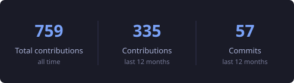
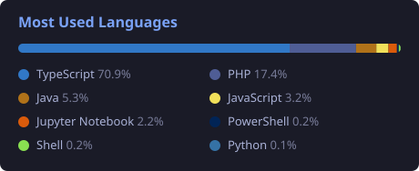
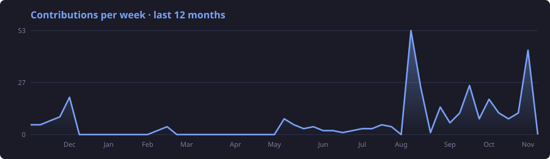

<h1 align="center">Hi, I'm Nícolas Deves 👋</h1>
<h3 align="center">Software Engineer · DevOps · Platform</h3>

  
  
  

---

### 🚀 About me

- 💼 **Software Engineer & DevOps**, with ~3 years building production software
- 🤖 Currently focused on **DevOps and AI**
- 🧩 **Full-stack** background
- 🎓 Studying **Software Engineering**

---

### 🛠️ Tech stack

**Languages**

**Backend & frontend**

**DevOps & cloud**

---

### 📊 GitHub stats

  

  

  

